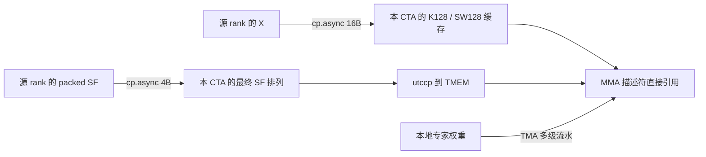

# SM100 直接拉取：消除共享内存二次重排

2026-11-26，EP4，GLM5.2 参数形状的合成数据。直接路径已改成“搬运时生成 MMA 布局、MMA 直接读缓存”，并完成一轮资源与调度优化。最终比旧直接路径降低约 11%–17% 延迟，仍慢于默认暂存路径，因此 `direct_pull=False` 继续作为默认。

## 最终实测

| T/rank | 旧直接路径 µs | 新直接路径 µs | 延迟下降 | 当前默认 LL µs | 当前原 GC API µs |
|---:|---:|---:|---:|---:|---:|
| 4 | 65.069 | 57.807 | 11.16% | 41.869 | 48.623 |
| 8 | 71.162 | 62.458 | 12.23% | 42.175 | 49.080 |
| 16 | 83.420 | 69.101 | 17.16% | 43.095 | 50.912 |
| 32 | 96.493 | 85.231 | 11.67% | 55.085 | 60.671 |

旧直接路径来自纯净 `878682f1db9e151125efcffbde12045397f7815c` 源码，使用本轮更新后的测试输入与参考计算；旧版本 BM 查询不接受 `direct_pull`，测试驱动仅在这一处适配。新旧分开进程先后执行；每个进程内部轮换三个算子的测量次序。不是同一个进程内新旧交替的严格配对实验。T=8 旧版有较明显的长尾，全部样本保留，百分比应视为本机本轮结果。

- H=6144、I=2048、top-k=8；32 个 routed 专家、每卡 8 个；1 个共享专家。
- 均衡时每专家 M=T/rank。routed FP4/K32、X FP8/K32、共享权重 FP8/K128。
- 单机 4 卡 capability 10.0，设备报告名 NVIDIA L20A；PyTorch 2.13.0+cu130、CuTe DSL 4.8.1、CUDA 13.2 ptxas。
- 测量机器另有四个 SGLang scheduler 常驻，每卡约占142,376MiB（约139GiB）；事后观察利用率0%–2%。没有停止这些进程，也没有锁频。这不是独占卡基准，低利用率快照不能证明计时期间完全没有干扰。
- 一次外层 CUDA Graph 含 50 次调用，11 次重复。每次取四 rank 最大时间，再取中位数。输入准备、JIT、权重变换不计时。
- EP4 对齐 EP32 的每卡专家数和均衡 M，不复现 EP32 fan-in、跨机拓扑与拥塞。没有实测 EP32，也不是模型 checkpoint/端到端推理测试。

原始数据：[新版本](benchmarks/gc_moe_ll_direct_final.json)、[旧提交控制组](benchmarks/gc_moe_ll_direct_old_control.json)。JSON 包含每次计时、逐 rank 误差、环境和 Python 源文件 SHA256。新版本测量时尚未提交，JSON 中 HEAD 是基底提交，应结合源码 hash，而不能将 HEAD 当成被测源码的完整身份。

## 数据现在怎么走



旧路径先把完整 token 按行连续拉进共享内存，再在每个 K128 循环中读到寄存器、重新排列并写入第二份 SMEM stage。现在 `cache_peer_tile` 在计算目的地址时就完成排列，删除了 `load_cached_k128` 的 SMEM→寄存器→SMEM 拷贝。

X 的逻辑布局为 `[K128块][本CTA的M半块][128字节]`。每组八个 lane 搬一行的八个 16B 片段，目标地址直接包含 SW128 的 XOR 映射。源地址仍按原 token 的连续 H 排布读取。源、目的布局不同，不要求先按原布局落入共享内存。

SF 的源数据是每个 token 的连续 K32 scale；一个 int32 打包四个 scale，对应一个 K128。搬运时直接写入 `row % 32 * 4 + row // 32` 的位置。四个 lane 合并读取同一 token 的相邻 K128 scale words，避免先逐标量同步读取、再重排。

两条连续 W1 N tile 复用同一缓存。每个 K128 的 activation loader 只等待流水槽可复用并发布 ready；MMA 从缓存地址读 X/SF，权重仍由原有 TMA 流水加载。共享专家与 W2 的 activation staging 保持原路径。

## 配套优化与必须补上的同步

1. **缓存生命周期变了。** 旧缓存只被 loader 读取，MMA 消费的是拷贝后的 stage。现在 MMA 直接读缓存，覆盖缓存之前必须等待上一消费者完成。两个 CTA 分别等待紧邻上一任务的 accumulator-full barrier；等待上一任务还能避免跟踪一个太旧、已经被复用的 barrier 世代。相同 pool block 命中时不覆盖缓存。
2. **异步搬运不是发出就完成。** X 每八个指令提交一组，SF 每四个指令提交一组，通过 `wait_group 6` 限制未完成组数；不足一组的尾部也提交。最终 `wait_group 0`、warp 同步和 async proxy fence 完成后，才允许发布给 MMA。硬件语义见 [NVIDIA PTX ISA](https://docs.nvidia.com/cuda/parallel-thread-execution/)。
3. **空行不走完整搬运循环。** 先批量清零 padding，只对包含有效行的 warp 分组发请求；空 CTA 半块不再为每个 K 块发空复制指令。
4. **压缩 SF 缓存。** BM16 时，MMA 只消费前 16 个 M 行，对应 64 个 uint32 地址槽。相邻 K 块的 512B `utccp` 读取窗口可以在未消费的部分重叠，因此 K stride 降为 256B。最后保留 256B guard，完整初始化，保证末次读取合法。H6144 时 SF 从 24KiB 降到 12.25KiB；X 缓存为 48KiB。BM32 使用完整 512B stride。
5. **分别选择 BM。** GLM5.2 均衡场景下，直接路径 T≤32 选 BM16，默认路径 T≤16 选 BM16、T=32 选 BM32。BM32 直接缓存会把计算流水压到 5 级；最终 BM16 直接路径有 8 级，默认 BM16 有 12 级。BF16/MMA/量化算法没有因此改变。
6. **寄存器与缓存布局统一计算。** 直接路径非 epilogue warpgroup 的寄存器预算由 40 提到 80，保留 epilogue 的 208，不超过 SM 总预算。寄存器调整收益较小；诊断编译没有 spill，不能称其修复了寄存器溢出。新增 host layout helper 同时用于 kernel 和 SMEM 预算，避免两处大小公式不一致。

## 实测淘汰的选择

以下为探索阶段结果，配置并非全部相同，不能把相邻行差值当成某一指令的独立耗时。完整计时样本见 [实验汇总](benchmarks/gc_moe_ll_direct_experiments.json)。

| 尝试 | T=32 直接路径，约 µs | 结论 |
|---|---:|---|
| 将最终布局拆成大量 16B bulk TMA 请求，SF 同步标量读取 | 219 | 去掉重排仍严重退步 |
| 改普通 cp.async，SF 异步直写 | 90 | 明显恢复，作为后续基础 |
| 无整块缓存，6个K块前瞻的直接流水 | 109 | 此实现没有收益，未保留 |
| 路由 CTA 从1增至4 | 94 | 未改善总延迟，保留1 |
| 寄存器80，W1 N分组1 | 116 | 复用下降，未保留 |
| 寄存器80，W1 N分组4 | 95 | 并行度下降，未保留 |
| 寄存器80，N分组2，BM32 | 91 | 继续作为 BM 对照 |
| N分组2，直接路径BM16 | 85 | 最终选择 |

最终收益同时来自搬运实现、SF 空间、BM 与寄存器安排；不能说减少的所有时间都是原来二次重排的耗时。

## 为什么还慢于默认路径

**去掉重排没有消除整块缓存等待。** 路由确定后，该 compute CTA 仍要等完整 X/SF tile 到达，才能开始对应 routed W1。共享专家可覆盖一部分等待，但没有测得它能完全覆盖。

**缓存占用了权重流水的空间。** 即使直接 routed W1 不再需要 activation stage 的拷贝，通用 role2 仍为 W2 和共享专家保留这些 stage，完整输入缓存是额外占用。最终直接路径 8 级，默认 12 级；W2/共享专家也继承同一份 role2 资源配置。这是下一步值得专门拆解的资源浪费。

**跨 N tile 的复用范围仍小。** I=2048 对应 16 个 W1 N tile，当前每 cluster 复用两个，因此一个路由的 X 可能触发八份逻辑 peer 读取。默认路径跨卡拉取一次，后续计算 CTA 读本卡暂存。八份请求可以并发，不等于八倍延迟；实际 NVLink 流量还受缓存影响，本轮没有链路带宽/拥塞计数器，不能断言链路已饱和。

**Profiler 定位到 role2，但不能进一步精确分摊。** 路由4 CTA 的诊断版本在 T32 时，role2 中位时长约84.5µs，对照默认路径约45.1µs；role1约20.0µs与28.4µs。角色之间有重叠，不能把这些时长相加。该诊断版不是最终 BM16 版本；数据见 [profiler 摘要](benchmarks/gc_moe_ll_direct_route4_profile_summary.json)。

后续有价值的方向是缩短整块输入的启动等待、让 W2/共享专家恢复较深权重流水，以及扩大输入在计算任务之间的共享范围。需要新的同步与任务调度设计；本轮没有把“直接拉 SMEM”证明成最优方案，也没有完成 W1/SwiGLU/W2 的 I 分片融合。

## 正确性与边界

- GLM形状：T=4/8/16/32，原 GC、默认 LL、直接 LL；均衡、随机、热点专家、全无效路由、部分无效路由，60组配置，每组4 rank。
- 无共享专家：T=0/1/7/17/31，两条 LL 路径，五种路由，50组配置。
- H1536/I2048：T=1/17/32，三条路径、五种路由，45组配置；覆盖不足一个异步提交组的 K 尾部。
- BM32分支：H1536/I2048、每卡2专家、Top-8、无共享专家、T=17/32，五种路由，10组配置；覆盖更大的每专家 M 与最后一个不满块。见[数据](benchmarks/gc_moe_ll_direct_final_bm32.json)。
- 每组比较独立 Torch 解量化参考，并运行 eager 和多次 CUDA Graph 重放。切换场景时同时更换 X/SF/路由权重及路由，复用已捕获的 Graph，检查旧缓存/旧信号问题。
- GLM主测试最大相对L2误差约0.001574，所有值有限；阈值为相对L2<0.025、cosine>0.999。旧、新版本60组逐rank误差摘要完全相同；这不等价于逐元素 bitwise 比较。
- [边界数据](benchmarks/gc_moe_ll_direct_final_edges.json)、[K尾部数据](benchmarks/gc_moe_ll_direct_final_h1536.json)。曾尝试 H512/I128 的额外测试，该测试的退化 SF stride 被已有输入契约拒绝，未进入 kernel；该形状不列为已验证。
- Compute Sanitizer 2026.1.1 的设备 memcheck：GLM形状 T=4/32、五种路由、eager/Graph，报告 `ERROR SUMMARY: 0 errors`，见[检查摘要](benchmarks/gc_moe_ll_direct_memcheck.log)。限定检查 GC CuTe kernels，并使用 `--report-api-errors no`：最初启用 API 报告时，CUDA Python 对13.1/13.2 API的探测被13.0驱动返回版本/参数错误；这些探测报告与设备访存检查分别记录，不能将本结果称作所有 CUDA API 都无错误。选项语义见 [NVIDIA Compute Sanitizer 文档](https://docs.nvidia.com/compute-sanitizer/ComputeSanitizer/)。

- Compute Sanitizer racecheck：H1536/I2048、T=17、直接路径、共享专家开启，均衡/热点/部分无效路由与 Graph，报告 `0 hazards (0 errors, 0 warnings)`，见[检查摘要](benchmarks/gc_moe_ll_direct_racecheck.log)。同样只检查 GC CuTe kernels、关闭 API 错误报告；此结果不等于对所有形状或跨 rank 全局显存竞争的形式化证明。

## 接口与复现

共享专家 SF 的布局必须与实际 BM 一致。`get_block_m_for_gc_moe_ll` 新增可选 `direct_pull`；查询与算子调用使用相同值。直接路径在 T32 的 BM 已改变，旧的手工准备 SF 代码需要更新。

```python
direct_pull = True
bm = gc_moe.get_block_m_for_gc_moe_ll(
    ep, experts, capacity, tokens, topk, direct_pull=direct_pull)
# 用 bm 准备 buffer.shared_l1_acts_sf；完整代码见测试 stage()。
gc_moe.fp8_fp4_gc_moe_ll(
    y, w1, w2, buffer, shared_w1, shared_w2,
    shared_recipe=(1, 128, 128), direct_pull=direct_pull)
```

```bash
unset PYTHONPATH
export PATH=/usr/local/cuda/bin:$PATH
python -m torch.distributed.run --nproc_per_node=4 \
  tests/bench_gc_moe_ll.py --tokens 4,8,16,32 \
  --variants gc,ll,ll_direct --repeats 11 --graph-calls 50 \
  --output results/ll/direct_final.json
```

代码入口：`common/direct_pull.py`（直接布局搬运）、`layout/direct_pull.py`（缓存大小和 SF guard）、`impls/sm100_fp8_fp4_gc_moe.py`（消费者地址与生命周期）、`mma/sm100.py`（独立 SF 偏移）、`apis/gc_moe_ll.py`（BM 查询和接口）。
